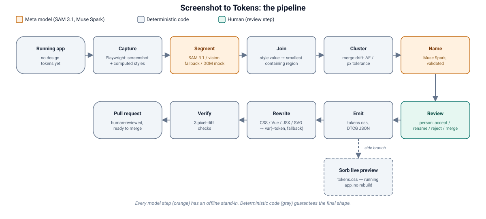

# Screenshot to Tokens

Point it at a running web app that has no design tokens. It captures the page, **SAM 3.1** segments the interface from
pixels (so it works where the markup says nothing), near-duplicate values are clustered, **Muse Spark** names a
three-tier token set (primitive → semantic → component, with a reason per token), a person accepts, renames or merges,
the hardcoded literals are rewritten to `var(--token, original)`, and a three-check pixel diff proves the rewrite itself
changes nothing before a pull request opens. **Sorb** then previews any token change live in your web app.

**One minute, no sound:** the page with no markup, one real run, the diff and the three checks, the live preview, the breadth table.

https://github.com/user-attachments/assets/3236827b-b139-4910-b9bc-252291838b0a

Built for the Meta Global AI Developer Hackathon (Oct 26 – Nov 4, 2026) by Metatoy. Every model step sits behind a
provider with an offline stand-in, so the pipeline runs without any API key; with keys it uses SAM 3.1 on the Meta
Model API and Muse Spark (hosted, or the open-weights Muse Spark Open served on Baseten).

**Measured (details in `docs/`):**

| | |
|---|---|
| Page with no semantic markup (`fixtures/div-soup`) | page structure finds **0 of 8** buttons; SAM 3.1 finds **8 of 8** (`docs/real-site-segeval.md`, `out/scoreboard.html`) |
| Three real dashboards (Argon, Light Bootstrap, Agency) | pass the token eval; rewrite safety **0 px** on all; Argon end to end in 23 s, naming 4.9 s, about $0.007 (`docs/latency.md`) |
| 28 public sites we didn't build | 2,313 values rewritten; **0 px** changed on 23 of 23 stable sites with edits; re-checked, same verdict on all 27 reachable (`docs/breadth.md`) |
| Hosted vs open weights | Muse Spark Open on Baseten names in 3 to 4.4 s vs 13.7 to 26 s hosted, identical fixture evals (`docs/f17-hosted-vs-open.md`) |
| Review | accept + rename + merge takes the fixture from 20/21 to 21/21 at 0 px (`demo/L5-review-take.md`) |
| Local playground | Muse Spark contrast audit 41 → 2 failing text pairs; dark theme 84/87 pairs pass (`docs/playground-muse.md`) |

Live demo: [original](https://nhunsaker.github.io/argon-dashboard-react/original/) · [tokenized](https://nhunsaker.github.io/argon-dashboard-react/tokens/) ·
[a proposed change, previewed](https://nhunsaker.github.io/argon-dashboard-react/tokens/?tokens=color-action-primary:e8711a) ·
[token playground](https://nhunsaker.github.io/argon-dashboard-react/playground/) · [the PR on our fork](https://github.com/nhunsaker/argon-dashboard-react/pull/1).

## Run it

```sh
pnpm install --ignore-workspace   # standalone repo inside a pnpm workspace folder
pnpm test
pnpm demo                         # fixture app, all stand-in providers → out/acme-shop/report.html
node src/cli.js eval --fixture acme-shop   # score the run against fixtures/acme-shop/golden.json
pnpm doctor                       # providers, keys, Ollama, Mac headroom
node src/cli.js segeval --run out/acme-shop          # segmenter vs DOM oracle boxes: GO / NO-GO
node src/cli.js compare out/acme-shop out/acme-shop-meta   # runs side by side
node scripts/access-day.mjs       # with Meta API access: probe response shapes, run everything, score
zsh scripts/demo-runs.sh          # the three demo apps end to end with the open-weights namer (S2T_NAMER=baseten)
```

Reports embed their images when they total under 8 MB and link them otherwise (`S2T_REPORT_IMAGES=embed|link`).

Static build: `node src/cli.js run --serve ./dist --target ./dist/css` (serves the folder, rewrites the target).
Dev server: `node src/cli.js run --url http://localhost:3000 --target ./src/styles`.
Re-run from one stage after switching a provider: `S2T_NAMER=ollama node src/cli.js run --fixture acme-shop --from name`.

After the run:

```sh
# 1. review in out/<run>/report.html, download review.json into the run folder, then
node src/cli.js review --run out/acme-shop
# 2. branch + commit in the app repo (add --open to push and open a draft PR)
node src/cli.js pr --run out/acme-shop --repo ../my-app --target ../my-app/src/styles
# 3. live preview a token change through a running Sorb bridge (`npx -p @sorb/juice sorb dev`)
node src/cli.js preview --token color.action.primary --value '#e8711a' --app-url http://localhost:3000
```

Plain HTML pages get live preview by adding `src/preview-client/sorb-preview.js` after `tokens.css`
(`<script src="sorb-preview.js" data-bridge="http://localhost:7777"></script>`); React apps use `@sorb/leaf`.
See `docs/sorb-preview.md`.

What the rewriter handles: plain `.css`, `<style>` blocks in `.vue` files (not `lang="scss"`), inline styles and
styled-components in `.js/.jsx/.ts/.tsx` (via `@sorb/seed`), and `fill` / `stroke` on inline SVG in `.html`.
It never touches `node_modules`, `.git` or build output folders.

## Pipeline

```
capture → segment → join → cluster → name → validate → emit → rewrite → verify → report
Playwright  SAM 3.1   bbox    ΔE / px   Muse Spark  repairs   tokens.css  var()      pixel diff  HTML
```

| Stage | Provider env | Stand-in (offline) | Real |
|---|---|---|---|
| segment | `S2T_SEGMENTER` | `mock`: regions from DOM boxes (an oracle; overstates quality) | `meta` SAM 3.1, `local` SAM on this machine |
| name | `S2T_NAMER` | `mock`: usage-driven heuristic names | `meta` Muse Spark 1.3, `baseten` Muse Spark Open (open weights), `ollama` local Llama, `fireworks` |
| review | `s2t review` | decisions exported from report.html (accept / rename / reject) | same |
| rewrite | `S2T_CODER` | `deterministic`: literal → `var(--token, original)` into `out/<run>/rewritten/` | same; `s2t pr` branches, commits and opens the draft PR |

The model proposes; deterministic code guarantees the shape. `validateTokenSet` makes sure every cluster
has exactly one primitive, aliases resolve without cycles and primitive values match what was captured.
If a provider fails, the run falls back to the heuristic and records a warning in `tokens.json`.

Verify runs three checks: with only the `var()` fallbacks the page must be pixel-identical (0 px); with the merged
color tokens loaded nothing may visibly change; with every token loaded the spacing cleanup is measured and shown
for review. A second shot of the unchanged page marks pixels that move between loads so animations don't count.
A fourth check measures text contrast (WCAG 2.x AA, SC 1.4.3) with the background read from the rendered pixels, and
fails a proposal that adds a failing pair (`docs/a11y.md`).

## Data policy

Only public, non-sensitive pages go to hosted models. Never enable a "Contributor" (trains on your data)
tier. Keys are read from the macOS Keychain or `.env` (git-ignored), never from code.

## Layout

```
src/cli.js, src/pipeline.js     entry + orchestration (each stage writes out/<run>/<stage>.json)
src/stages/                     capture, join, cluster, name (validate), emit, rewrite, verify, report, eval, review, pr, preview
src/providers/segment/          mock, meta-sam (SAM 3.1), local-sam (+ scripts/sam_local.py)
src/providers/llm/              chat (OpenAI-compatible), heuristic, llm-namer
src/providers/coder/            deterministic (CSS + Vue), jsx, svg-attrs, meta-code
src/preview-client/             sorb-preview.js (no-build live preview for plain HTML)
fixtures/acme-shop/             demo storefront with deliberate drift + golden.json
docs/                           providers-research.md, demo-script.md, demo-targets.md, sorb-preview.md
test/fake-meta.test.js          contract test against a fake Meta API (rerun shapes on access day)
```

Builds on the published [`@sorb/seed`](https://www.npmjs.com/package/@sorb/seed) normalizers (Apache-2.0).

## Architecture



Capture, join, cluster, emit, rewrite, and verify are deterministic code. Segment and name are the
two Meta model steps (SAM 3.1, Muse Spark), each with an offline stand-in. Review is a human step.
Full write-up: [`docs/SUBMISSION.md`](docs/SUBMISSION.md).

## Submission

Hackathon submission text, built-with-Meta-models detail, what was proven with real numbers, and
honest limits: [`docs/SUBMISSION.md`](docs/SUBMISSION.md).
